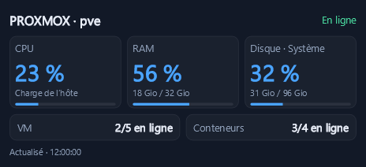
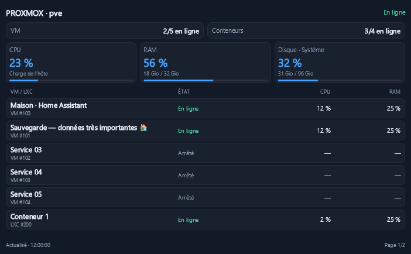
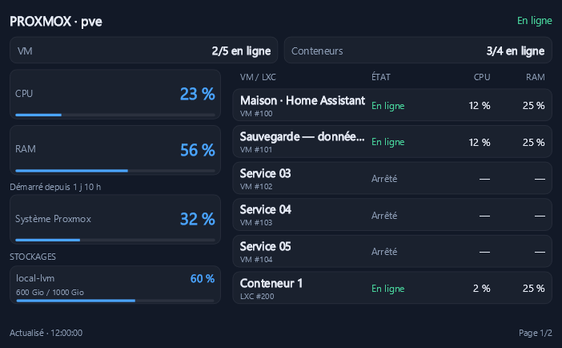
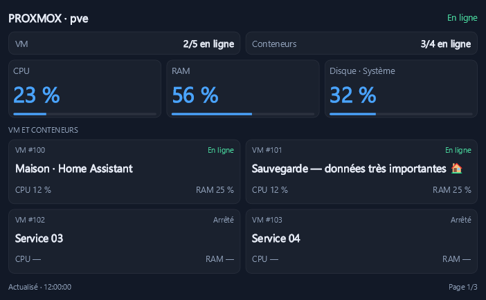

# Proxmox Monitor pour AshBoard Vision

Module communautaire de **Macorou** pour surveiller un serveur **Proxmox VE autonome**, ses VM QEMU et ses conteneurs LXC dans AshBoard Vision.

Version stable actuelle : **0.1.0**. Contrat requis : **SDK AshBoard Vision 1.0**. VE 8/9 sont les cibles de compatibilité ; leur compatibilité en exploitation reste à valider. Voir [les vérifications](docs/validation.md).

## Fonctions

- Charge CPU, RAM et occupation du disque système ou d’un stockage choisi.
- États et compteurs des VM et conteneurs : démarré, arrêté, pause/suspension ou inconnu.
- Trois présentations détaillées : **Équilibrée**, **Ressources**, **Mosaïque**.
- Compact **4 × 2** : monitoring de l’hôte et compteurs distincts, par exemple **VM 2/5 en ligne** et **Conteneurs 3/4 en ligne**.
- Rotation automatique des longues listes, durée réglable ; monitoring de l’hôte et compteurs globaux fixes.
- Trois thèmes SDK, taille de texte de l’application, stockage du jeton dans le coffre chiffré SDK.

Le module utilise uniquement des GET. Il n’envoie aucune commande aux invités et ne nécessite aucun agent sur Proxmox. Les clusters, tunnels localhost, commandes clavier et historiques ne font pas partie de cette version.



*Captures de données fictives, produites par le véritable rendu SkiaSharp du module.*

## Installer

[Télécharger la version stable 0.1.0 et son empreinte SHA256](https://github.com/Macorou/Module-PXE-pour-AshBoard-Vision/releases/tag/v0.1.0).

Le fichier à installer est `macorou.proxmox-monitor-0.1.0.avmod`. Son fichier `.sha256` permet de contrôler l’intégrité. Pour utiliser le module, aucun SDK de développement n’est nécessaire.

1. Ouvre le `.avmod`, ou utilise « Installer un module… » dans les paramètres d’AshBoard Vision.
2. Accorde **Réseau local** pour un serveur privé et/ou **Internet** pour un serveur distant, selon sa classification Windows.
3. Pose le module sur le damier, puis ouvre ses paramètres.
4. Renseigne l’adresse HTTPS et le **jeton API complet** ; teste la connexion, puis enregistre.
5. Ferme complètement puis rouvre la fenêtre des paramètres pour charger les stockages découverts, puis choisis une vue et le stockage de l’indicateur disque. Si la liste était vide avant le test, le bouton « Actualiser » permet aussi de la recharger.

[Guide de configuration Proxmox et connexion](docs/configuration-proxmox.md).

La taille minimale est 4 × 2 ; 6 × 4 est la taille détaillée conseillée. Le compact s’active aussi quand la tuile fait moins de six colonnes ou moins de trois lignes. La préférence de vue détaillée est conservée lors d’un redimensionnement.

## Comprendre les données

« En ligne » signifie démarré selon Proxmox. Le module ne teste pas la disponibilité des services ou du réseau à l’intérieur de l’invité. Les modèles ne comptent pas comme des machines à démarrer. Une VM en pause/suspension est identifiée séparément.

Les compteurs couvrent tous les invités accessibles avec des droits vérifiés sur le serveur, quelle que soit la page visible. Une configuration aux droits incomplets est refusée pour éviter un total partiel. Une panne de connexion donne des données inconnues, sans convertir tous les invités en arrêtés. Les anciennes mesures sont atténuées et datées, puis retirées après `max(30 secondes, deux intervalles)`.

La RAM est celle rapportée par Proxmox. Pour une VM, elle peut dépendre du ballooning et différer de ce que montre le gestionnaire de tâches de l’OS invité. Un stockage représente un espace Proxmox ; les capacités ne sont jamais additionnées et ne mesurent pas le remplissage interne des systèmes de fichiers invités.







## Paramètres

| Paramètre | Valeur initiale |
| --- | --- |
| Présentation | Équilibrée |
| Compact forcé | Non |
| Disque | Système Proxmox |
| Actualisation | 10 s, réglable de 5 à 60 s |
| Durée de page | 8 s, réglable de 3 à 30 s |
| Certificat auto-signé | Non ; activation possible avec mémorisation explicite au test |

Couleurs de charge : normale sous 80 %, attention à partir de 80 %, critique à partir de 90 %. Il n’y a pas de notification système.

Toutes les tuiles du module partagent **une connexion et un jeton**. Elles peuvent afficher différentes vues et différents stockages de ce même serveur. Un nouveau serveur ou jeton doit être testé ; les anciennes tuiles ne réutilisent pas automatiquement le jeton vers une autre adresse. Un test attend la fin d’une courte collecte en cours avant de modifier la liaison ou le certificat.

## Développer et vérifier

Pré requis : Windows x64, SDK .NET 10 et outils officiels AshBoard Vision 1.0.0. PowerShell 7 est conseillé pour les scripts et utilisé par les tests d’empaquetage. Le SDK AshBoard Vision est fourni par son installateur ou ses versions officielles, jamais téléchargé comme paquet homonyme sur nuget.org.

```powershell
.\scripts\prepare-sdk.ps1 -SdkDirectory 'C:\Program Files\Ashboard Vision\sdk'
dotnet restore .\ProxmoxMonitor.slnx
.\scripts\verify.ps1
.\scripts\pack.ps1 -ModuleId 'macorou.proxmox-monitor' -Author 'Macorou' -Repository 'Macorou/Module-PXE-pour-AshBoard-Vision' -Version '0.1.0'
```

Les paquets SDK sont copiés dans `.sdk-feed`, les autres dépendances dans `.packages`, sans modifier les sources NuGet globales. Les versions transitives sont verrouillées. Si les dépendances exactes sont déjà présentes dans un cache local mais que l’accès réseau de développement est restreint, `verify.ps1 -OfflineFallback '<dossier du cache NuGet>'` peut les relire sans désactiver la validation TLS.

Les tests ne contactent aucun Proxmox réel. Deux tests utilisent de vrais serveurs TLS localhost, avec certificats de test non ajoutés aux magasins de confiance Windows. Un environnement de développement isolé qui interdit SChannel peut empêcher ces deux tests et le banc SDK ; les exécuter dans une session Windows normale.

Les PNG synthétiques se trouvent dans `artifacts/previews`, les sorties du banc dans `artifacts/check` et le paquet final dans `artifacts/packages`. Le banc SDK démarre sans configuration : son résultat ne prouve pas une connexion réelle à Proxmox.

## Distribution et licence

Dépôt des sources et des versions : [Macorou/Module-PXE-pour-AshBoard-Vision](https://github.com/Macorou/Module-PXE-pour-AshBoard-Vision).

Chaque version GitHub portant `v<version>` fournit le `.avmod`, son `.sha256` et les sources correspondantes. AshBoard Vision gère les propositions de mises à jour selon son SDK et les versions effectivement publiées.

Copyright © 2026 Macorou. Code sous **GPL-3.0-or-later**, voir [LICENSE](LICENSE). Le SDK AshBoard Vision est sous GPL-3.0-or-later et SkiaSharp sous MIT ; leurs bibliothèques sont fournies par l’hôte et ne sont pas dupliquées dans le `.avmod`.
